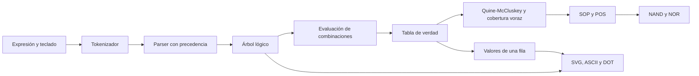
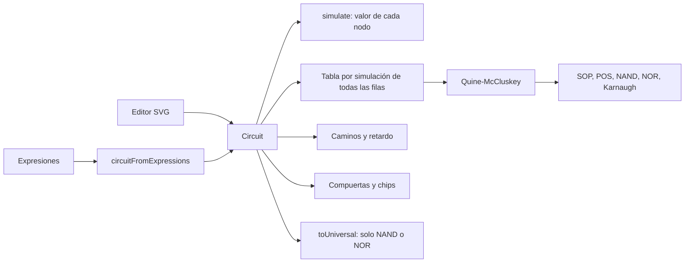

# Arquitectura de LogicLab

LogicLab es una aplicación de una sola página, ejecutada en el navegador. React administra la interfaz original, TypeScript comprueba tipos en modo estricto y Vite transforma el código para producción. Tailwind CSS compila las clases presentes en la interfaz; Lucide React proporciona los iconos. No hay servidor de aplicación, API, autenticación, almacenamiento persistente ni variables de entorno obligatorias.

## Flujo de procesamiento

## Componentes

| Archivo | Responsabilidad |
|---|---|
| `src/main.tsx` | Montaje de React y carga de estilos |
| `src/App.tsx` | Entrada, teclado, ejemplos, pestañas, reglas y resultados; incluye `SvgLogicCircuit`, `LogicGateNode`, `ResultCard`, `CopyButton`, `SymbolTable` y `RuleGroup` |
| `src/logic/boolean.ts` | Tokenización, parser, AST, evaluación, implicantes, formatos, anotación y exportación de diagramas; no depende de React |
| `src/Shell.tsx` | Raíz: navegación entre calculadora, editor y ejercicios; el editor se mantiene montado para conservar el circuito |
| `src/logic/circuit.ts` | Modelo de circuito (nodos y cables), simulación, detección de ciclos, expresión, caminos, costo/chips, acomodo, construcción desde expresiones y conversión a NAND/NOR; no depende de React |
| `src/logic/karnaugh.ts` | Disposición en código Gray y grupos de Karnaugh a partir del resultado de Quine-McCluskey |
| `src/logic/exercises.ts` | Banco de ejercicios, verificación por equivalencia, contraejemplos y generador aleatorio con semilla |
| `src/components/CircuitEditor.tsx` | Lienzo SVG con arrastre, cableado por arrastre o por clic, historial, zoom, importación y exportación |
| `src/components/CircuitAnalysis.tsx` | Tabla, expresión, Karnaugh, caminos y costo del circuito dibujado |
| `src/components/KarnaughView.tsx` | Mapa de Karnaugh reutilizado en la calculadora, el editor y los ejercicios |
| `src/components/ExercisesView.tsx` | Lista, progreso en `localStorage`, pistas y los cuatro tipos de ejercicio |
| `src/styles.css` | Tokens de diseño (`@theme static`: marca `brand-*`, `ink`, `muted`, `canvas`, `line`, `signal-on/off`, `radius-card`, `shadow-card`), foco visible, `scroll-padding-top` por la cabecera fija y movimiento reducido |
| `src/components/ui.tsx` | Componentes base del sistema de diseño: `Button`, `LinkButton`, `Card`, `CardLink`, `Badge`, `PageContainer`, `PageHeader` (el único `h1` de cada vista) y `Section` |
| `src/components/SiteChrome.tsx` | `SiteHeader` (cabecera global única, fija) y `SiteFooter`, con la marca de LogicLab |
| `src/components/Home.tsx` | Página de inicio: presentación con demo interactiva, herramientas, ruta de aprendizaje |
| `tests/unit/boolean.test.ts` | Sintaxis, equivalencias y regresiones del motor |
| `tests/e2e/app.spec.ts` | Flujos, tamaños de pantalla, axe y rendimiento sobre el build |
| `.github/workflows/ci.yml` | Validaciones en pushes y pull requests a main |
| `vercel.json` | Framework Vite, instalación reproducible y salida `dist` |

## Motor conservado y correcciones

El parser descendente conserva la precedencia original: paréntesis y NOT, AND, XOR, OR. Los identificadores distinguen mayúsculas y minúsculas; las palabras de operadores no. `BC` es un identificador, mientras `B*C` es conjunción. Se admite una asignación opcional `F = expresión`, que solamente etiqueta la entrada; no guarda variables.

Las constantes 0 y 1 se representan como hojas reservadas del AST y no se cuentan como variables. Se rechazan caracteres desconocidos y asignaciones mal formadas. El evaluador recorre el AST sin ejecutar texto como JavaScript. Los entornos se crean sin prototipo para aceptar nombres como `__proto__` de forma consistente.

Se enumeran hasta 2^12 combinaciones. Con más de 12 variables se mantiene el comportamiento original: se omiten tabla y simplificación, pero puede verse el árbol de la entrada. La entrada está limitada a 2000 caracteres. El algoritmo combina implicantes y selecciona esenciales; la cobertura restante es voraz. Por ello **no se garantiza una expresión globalmente mínima**, aunque la equivalencia sí puede comprobarse. La UI valida SOP frente a cada fila original. Las pruebas también verifican POS y las representaciones NAND/NOR con un evaluador independiente de compuertas universales de múltiples entradas.

Se corrigió la polaridad de los literales NOR derivados del complemento. El resto del algoritmo de simplificación se conserva. No se implementó una traza de transformaciones educativas: RF-02 y RF-03 siguen incompletos.

## Editor de circuitos y ejercicios

El circuito es un grafo dirigido acíclico: `Circuit = { nodes, wires }`, donde cada cable une la salida de un nodo con un pin de entrada de otro y cada pin admite un solo cable. `connect` rechaza ciclos con una búsqueda hacia adelante. Todo el análisis se calcula sobre ese modelo:

La tabla de verdad sale de **simular el circuito**, no de reinterpretar una expresión; así una conversión a NAND/NOR se puede comprobar contra el circuito original. `toUniversal` reconstruye el grafo con compuertas universales, comparte subcircuitos idénticos y cancela dobles inversiones; después `pruneDead` retira compuertas que quedaron sin uso.

Los ejercicios se verifican comparando funciones fila por fila (hasta 12 variables) y devuelven el primer contraejemplo. En los ejercicios de circuito se simula el dibujo del alumno contra la expresión de referencia y se comprueban las restricciones (compuertas permitidas y máximo). El generador aleatorio usa un congruencial lineal con semilla para que un ejercicio sea reproducible.
