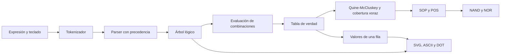

# Arquitectura de LogicLab

LogicLab es una aplicación de una sola página, ejecutada en el navegador. React administra la interfaz original, TypeScript comprueba tipos en modo estricto y Vite transforma el código para producción. Tailwind CSS compila las clases presentes en la interfaz; Lucide React proporciona los iconos. No hay servidor de aplicación, API, autenticación, almacenamiento persistente ni variables de entorno obligatorias.

## Flujo de procesamiento

## Componentes

| Archivo | Responsabilidad |
|---|---|
| `src/main.tsx` | Montaje de React y carga de estilos |
| `src/App.tsx` | Entrada, teclado, ejemplos, pestañas, reglas y resultados; incluye `SvgLogicCircuit`, `LogicGateNode`, `ResultCard`, `CopyButton`, `SymbolTable` y `RuleGroup` |
| `src/logic/boolean.ts` | Tokenización, parser, AST, evaluación, implicantes, formatos, anotación y exportación de diagramas; no depende de React |
| `src/styles.css` | Tailwind, foco visible y preferencia de movimiento reducido |
| `tests/unit/boolean.test.ts` | Sintaxis, equivalencias y regresiones del motor |
| `tests/e2e/app.spec.ts` | Flujos, tamaños de pantalla, axe y rendimiento sobre el build |
| `.github/workflows/ci.yml` | Validaciones en pushes y pull requests a main |
| `vercel.json` | Framework Vite, instalación reproducible y salida `dist` |

## Motor conservado y correcciones

El parser descendente conserva la precedencia original: paréntesis y NOT, AND, XOR, OR. Los identificadores distinguen mayúsculas y minúsculas; las palabras de operadores no. `BC` es un identificador, mientras `B*C` es conjunción. Se admite una asignación opcional `F = expresión`, que solamente etiqueta la entrada; no guarda variables.

Las constantes 0 y 1 se representan como hojas reservadas del AST y no se cuentan como variables. Se rechazan caracteres desconocidos y asignaciones mal formadas. El evaluador recorre el AST sin ejecutar texto como JavaScript. Los entornos se crean sin prototipo para aceptar nombres como `__proto__` de forma consistente.

Se enumeran hasta 2^12 combinaciones. Con más de 12 variables se mantiene el comportamiento original: se omiten tabla y simplificación, pero puede verse el árbol de la entrada. La entrada está limitada a 2000 caracteres. El algoritmo combina implicantes y selecciona esenciales; la cobertura restante es voraz. Por ello **no se garantiza una expresión globalmente mínima**, aunque la equivalencia sí puede comprobarse. La UI valida SOP frente a cada fila original. Las pruebas también verifican POS y las representaciones NAND/NOR con un evaluador independiente de compuertas universales de múltiples entradas.

Se corrigió la polaridad de los literales NOR derivados del complemento. El resto del algoritmo de simplificación se conserva. No se implementó una traza de transformaciones educativas: RF-02 y RF-03 siguen incompletos.
